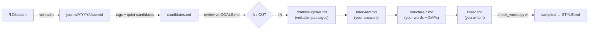

<div align="center">

# ✍️ writing-coach

**An AI writing coach that changes the structure, never your words.**

Turn messy voice notes into LinkedIn posts and blog articles that still sound like you, because every word *is* yours.

[](https://github.com/franndeli/writing-coach/actions/workflows/ci.yml)
[](https://github.com/franndeli/writing-coach/releases)
[](https://www.npmjs.com/package/writing-coach)
[](https://www.npmjs.com/package/writing-coach)
[](LICENSE)
[](https://agentskills.io)
[](#install)
[](https://pi.dev/packages/writing-coach)

[Install](#install) · [Quick start](#quick-start) · [Example](examples/README.md) · [How it works](#how-it-works) · [FAQ](#faq)

</div>

---

Most AI writing help makes posts sound like AI. **writing-coach** does the opposite. It works on *what to lead with,
what to cut, where the argument is thin*, and asks you for anything missing instead of making it up:

```
[GAP: the post ends on the idea but gives the reader nothing to do. What would you want another manager to try on Monday?]
```

A checker script then proves the final text is yours:

```console
$ python3 check_words.py drafts/meetings-tax/final-linkedin.md
✅ drafts/meetings-tax/final-linkedin.md: all 150 words are yours.

$ python3 check_words.py drafts/meetings-tax/polished-by-ai.md
⚠️  8 of 36 words not found in your text.
  line 1: Meetings are silently draining our team's productivity.
      ✗ silently draining our team's productivity
```

## Before → after

<table>
<tr><th>What Alex dictated (three different days)</th><th>What Alex posted</th></tr>
<tr><td valign="top">

*ok so today's thing. we had the weekly sync and I counted, eleven people in the room for forty five minutes and like
two decisions. two. and honestly nobody's fault, it's the format. I keep thinking we are paying a meeting tax that
nobody approved. anyway also the new hire Priya shipped her first PR…*

*tired. tried something, I cancelled the status part of the sync and asked everyone to write a three line update in
the channel before monday. people were suspicious. Marco said it feels like we stopped talking. fair point actually.
but the meeting went from forty five minutes to fifteen…*

*random thought on the bike, the meeting tax is real but the fix isn't fewer meetings, it's meetings that only do what
writing can't. arguing. deciding. feeling the room. also need to book the dentist*

</td><td valign="top">

We are paying a meeting tax that nobody approved.

Eleven people in the room for forty five minutes. Two decisions. Two.

And honestly nobody's fault, it's the format.

So I cancelled the status part of the sync and asked everyone to write a three line update in the channel before Monday.

People were suspicious. Marco said it feels like we stopped talking.

Fair point actually. But the meeting went from forty five minutes to fifteen, and we spent the fifteen on the one hard
problem: we decided to drop the custom deploy script and move to the standard pipeline. […]

The fix isn't fewer meetings, it's meetings that only do what writing can't. Arguing. Deciding. Feeling the room.

Cancel the status part of one meeting. Just one. See what is left.

</td></tr>
</table>

Alex is fictional. See the [full walkthrough](examples/README.md): the journal, the review verdicts, the interview,
the restructure with its gap, and the feedback that became a rule.

## Features

- 🔒 **Your words only.** Allowed: reorder, cut, split, merge, promote a line to a hook, and a short list of glue words (`and`, `but`, `so`…). Everything else becomes a `[GAP]` question. `check_words.py` enforces it.
- 🎙️ **Voice journal.** Dictate your day; it's saved verbatim and append-only, and tagged quietly. No "you should post this!" nagging.
- 🧐 **A critical filter, not an idea machine.** Ask for a review and ideas are ruled **IN or OUT** against your `GOALS.md`, with reasons. "Nothing worth posting this week" is a normal answer.
- 🧠 **Learns without overgeneralizing.** Feedback is scoped `post` or `preference`. A preference only becomes a style rule after 3 consistent decisions or an explicit "never", and only through a diff you approve.
- 🪞 **Style ≠ coaching.** `STYLE.md` describes how *you* write, with citations from your posts. The coaching rules live in the skill. Improve one without touching the other.
- 🛡️ **Private by design.** Your writing lives in your own workspace, never in this repo. `doctor.py` fails loudly if your workspace's git remote is public.
- 🧰 **Works with your agent.** One Agent Skill for Claude Code, Codex, Cursor, Pi, OpenCode, Gemini CLI and more. Plain Markdown plus dependency-free Python on macOS, Linux and Windows.

## Install

| Agent | Command |
|---|---|
| **Claude Code** (plugin, adds `/writing-coach:*` commands) | `/plugin install writing-coach --marketplace franndeli/writing-coach` |
| **Pi** (package, adds `/journal`, `/review-journal`, …) | `pi install npm:writing-coach` |
| **Codex, Cursor, OpenCode, Gemini CLI, …** ([skills CLI](https://skills.sh)) | `npx skills add franndeli/writing-coach -g` |
| **Manual** | Copy `skills/writing-coach/` into your agent's skills folder (e.g. `~/.claude/skills/`, `~/.codex/skills/`) |

On older Claude Code versions, use two steps: `/plugin marketplace add franndeli/writing-coach`, then `/plugin install writing-coach@writing-coach`.

Requirements: Python 3.9+ (preinstalled on macOS; on Windows use `python` or `py` instead of `python3`). No other dependencies.

## Quick start

1. **Create your private workspace.** Ask your agent *"create my writing workspace"*, or run:
   ```sh
   python3 <skill-dir>/scripts/init_workspace.py ~/writing
   ```
2. **Open your agent in `~/writing`** and say:
   - *"Set up my writing goals"*: a short interview that fills in `GOALS.md`.
   - Drop 10–20 of your published posts in `samples/linkedin/` and `samples/blog/`, then say *"Analyze my samples and generate STYLE.md"*.
3. **Live your life.** Whenever something happens: *"Journal:"* followed by your dictation.
4. **Weekly:** *"Review my journal, is anything worth posting?"*
5. **For an idea that's ruled in:** *"Promote it"*, then *"Interview me"*, *"Restructure for LinkedIn"*, *"Challenge it"*.
6. **Write the final yourself** (fill the gaps), then *"Check my words"* and *"Publish"*.
7. Accept or reject suggestions by number, and the coach learns.

<details>
<summary><b>All commands</b> (Pi: <code>/name</code> · Claude Code: <code>/writing-coach:name</code> · any agent: just ask)</summary>

| Command | What it does |
|---|---|
| `coach-init [dir]` | Create your private workspace (default `~/writing`) |
| `doctor` | Health and privacy check (flags public git remotes) |
| `goals` | Interview → `GOALS.md` |
| `journal` | Save a dictation verbatim to today's entry |
| `review-journal [period]` | Rule candidates IN or OUT against your goals |
| `promote <candidate> [slug]` | Turn an IN idea into a draft built from verbatim journal passages |
| `bootstrap-style` | Generate `STYLE.md` from your samples, with citations |
| `new-draft <slug>` | Start a draft from scratch |
| `interview <slug>` | Get asked the questions a skeptical reader would ask |
| `restructure <slug> [linkedin\|blog]` | Rebuild the draft from your words, with `[GAP]`s |
| `challenge <slug>` | Critique the argument and structure |
| `check <slug> [platform]` | Verify the final uses only your words |
| `learn <slug> <decisions>` | Log accept/reject decisions (post vs preference) |
| `update-style` | Propose `STYLE.md` changes from accumulated feedback |
| `publish <slug> [platform]` | Archive the approved final into `samples/` |

</details>

## How it works



The **tool** (this repo) is public. Your **workspace** is a separate private folder:

| In your workspace | What it is |
|---|---|
| `STYLE.md` | How you write: tone, rhythm, vocabulary, structure, LinkedIn vs blog, each claim citing your samples |
| `GOALS.md` | Why you post, audience, topics you post about and never post about, comfortable cadence |
| `samples/` | Your published posts. This is the style evidence. |
| `journal/` | Verbatim dictations, candidate quotes, monthly digests |
| `drafts/<slug>/` | `raw.md` (immutable) → `interview.md` → `structure-*.md` → your `final-*.md` |
| `feedback/` | Accept/reject log, plus preferences waiting for promotion |
| `AGENTS.md` | Your personal overrides of the coaching rules |

**Why no vector database?** Journal memory is compressed *when you record it* (theme tags, short candidate quotes,
monthly digests), and reviews read those small layers before opening specific entries with plain text search. At
about 600 tokens a day, that holds up for years. Everything stays plain Markdown in git: portable across AI providers,
and you can see how your style evolves.

## Privacy

- Your workspace never leaves your machine unless you push it. If you do, keep the remote **private**. `doctor.py` checks this, and the coach runs it before every journal review.
- Your agent sends the files it reads to its model provider. Your journal is the most sensitive part, so choose a provider (or a local model) you trust with it.
- This repo never contains anyone's real writing. A test enforces that the workspace template stays empty.

## FAQ

**Can't I just ask ChatGPT not to change my words?** You can ask. Models drift anyway: a smoother transition here, a
punchier verb there. This project makes the rule checkable with `check_words.py`, and turns every missing piece into a question for you.

**What about typos and grammar?** Small fixes (capitalization, agreement after merging two sentences) are listed
separately for your approval. Approved ones go in the draft's `allow.txt` and count as yours.

**Does it work in languages other than English?** Yes. The checker is language-agnostic, and the glue list ships with
English and Spanish. Add your language's connectors to `glue_words.txt` (or a workspace-level `glue_words.txt`).

**Will it make me post every day?** No. It's designed to rule ideas *out*. The review defaults to OUT and rules in at most about three ideas.

**How do I update?** Update the plugin/package (`npx skills update`, `pi update --extensions`, or `/plugin` in Claude Code), then
re-run `init_workspace.py` on your workspace to add any new template files. Existing files are never touched.

## Contributing

Issues and PRs are welcome. See [CONTRIBUTING.md](CONTRIBUTING.md). The two non-negotiables: the coach never adds
words of its own, and no real personal writing in the repo.

## License

[MIT](LICENSE) © Francisco José Delicado González
